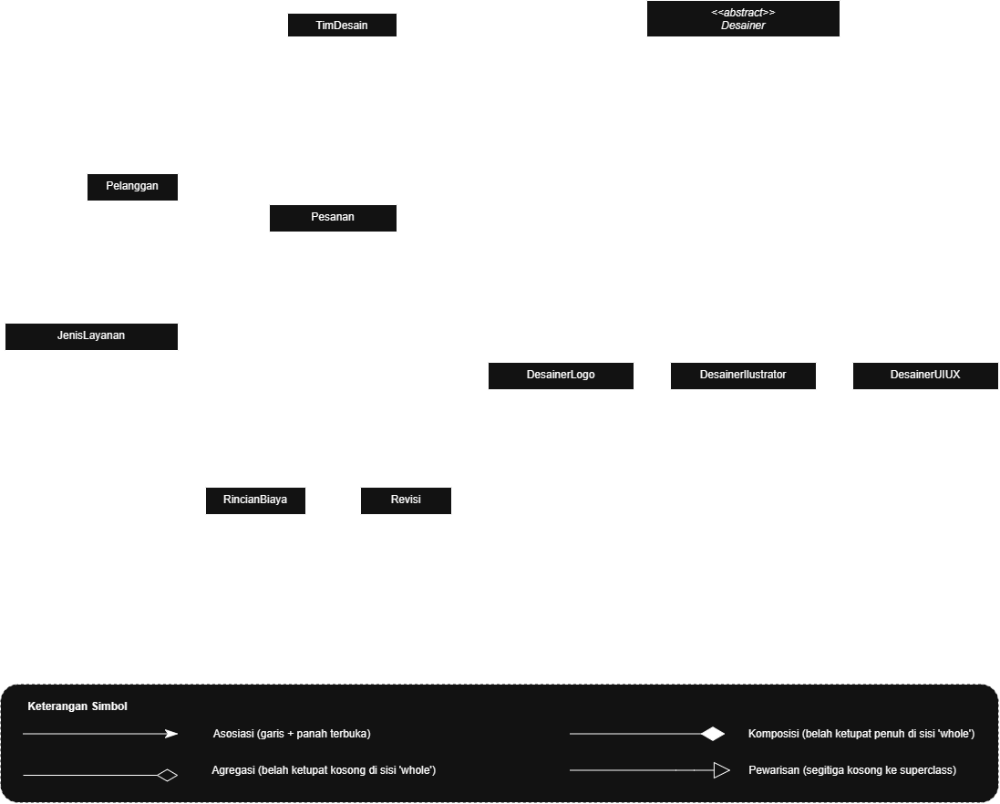
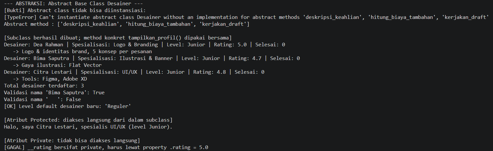
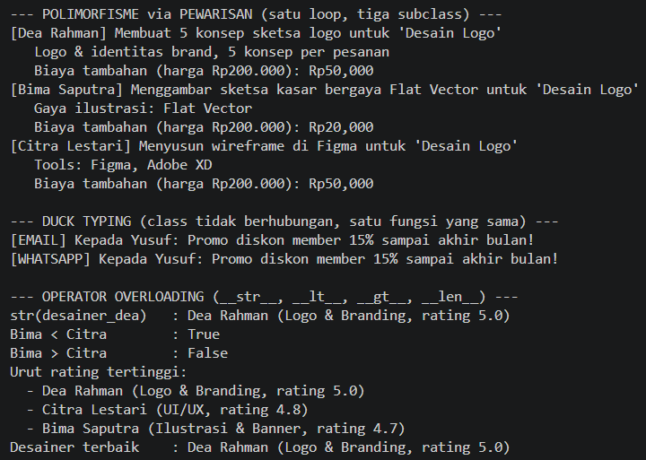
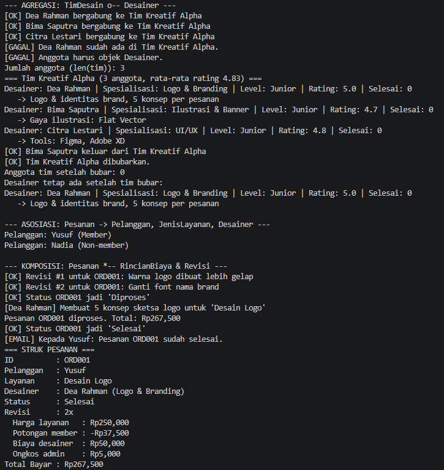

# Sistem Manajemen Pesanan Desain Grafis — Desaignkan_id

Program Python berbasis **Object-Oriented Programming (OOP)** untuk mengelola pesanan
jasa desain grafis pada usaha kreatif fiktif **Desaignkan_id**, berdasarkan jenis layanan
(logo, banner, UI/UX, dll). Pelanggan membuat pesanan, pesanan dikerjakan oleh desainer
sesuai spesialisasinya, lalu biaya dihitung otomatis dan struk ditampilkan.

Materi yang diterapkan:
- Modul 1 — Pengantar OOP, Class, dan Object
- Modul 2 — Atribut dan Method
- Modul 3 — Encapsulation
- Modul 4 — Encapsulation
- Modul 5 — Inheritance
- Modul 6 — Polimorfisme & Abstraksi
- Modul 7 — SOLID

---

## 1. Class Diagram



### Penjelasan Relasi

**Asosiasi** — `Pesanan` → `Pelanggan`, `Pesanan` → `JenisLayanan`, dan `Pesanan` → `Desainer`.
Pesanan hanya *menggunakan* ketiga objek itu (disimpan sebagai referensi lewat constructor);
masing-masing dibuat dan hidup sendiri di luar `Pesanan`, jadi relasinya hanya asosiasi.
Di kode: `Pesanan(id, pelanggan, layanan, desainer)`.

**Agregasi** — `TimDesain` o-- `Desainer`. Tim *memiliki* banyak desainer, tetapi objek
`Desainer` dibuat di luar tim dan dimasukkan lewat `tambah_anggota()`. Saat tim dibubarkan
(`bubarkan()`), desainer **tetap ada** dan bisa masuk tim lain, karena itu dipilih agregasi,
bukan komposisi.

**Komposisi** — `Pesanan` *-- `RincianBiaya` dan `Pesanan` *-- `Revisi`. Kedua objek ini
dibuat **di dalam** `Pesanan` (`RincianBiaya()` di `__init__`, `Revisi(...)` di
`tambah_revisi()`), disimpan sebagai atribut private, dan tidak punya arti tanpa pesanannya.
Jika `Pesanan` dihapus, rincian biaya dan revisinya ikut hilang, karena itu dipilih
komposisi, bukan agregasi.

| Relasi | Dari → Ke | Dibuat oleh | Jika "whole" dihapus |
|---|---|---|---|
| Asosiasi | `Pesanan` → `Pelanggan`, `JenisLayanan`, `Desainer` | Di luar class | Objek lain tetap ada |
| Agregasi | `TimDesain` o-- `Desainer` | Di luar class | Anggota tetap ada |
| Komposisi | `Pesanan` *-- `RincianBiaya`, `Revisi` | Di dalam class | Bagian ikut hilang |

---

## 2. Penerapan Abstraksi

**Abstract class: `Desainer(ABC)`** — tidak bisa diinstansiasi langsung.

| Bagian | Isi |
|---|---|
| Abstract method (3) | `hitung_biaya_tambahan()`, `deskripsi_keahlian()`, `kerjakan_draft()` |
| Subclass yang mengimplementasikan semua abstract method (3) | `DesainerLogo`, `DesainerIlustrator`, `DesainerUIUX` |
| Method konkret (dipakai bersama semua subclass) | `jalankan()`, `tampilkan_profil()`, `tambah_pesanan_selesai()` |

`jalankan(layanan)` adalah method konkret yang memanggil `kerjakan_draft()` (abstract), sehingga
urutan kerja sama untuk semua desainer tetapi isi langkahnya ditentukan masing-masing subclass.

**Bukti abstract class tidak dapat diinstansiasi** (di `main.py`):

```python
try:
    desainer_abstrak = Desainer("Tes", "Tes")
except TypeError as error:
    print("[TypeError]", error)
```

Output:

```
[TypeError] Can't instantiate abstract class Desainer without an implementation for abstract methods 'deskripsi_keahlian', 'hitung_biaya_tambahan', 'kerjakan_draft'
```

**Inheritance dari posttest sebelumnya tetap dipakai:**
- `super().__init__(...)` dipanggil di setiap subclass.
- Atribut unik: `DesainerLogo.jumlah_konsep`, `DesainerIlustrator.gaya_ilustrasi`, `DesainerUIUX.tools`.
- Protected `_nama`, `_spesialisasi`, `_level` dipakai langsung oleh subclass (contoh `DesainerUIUX.sapa_tim()`).
- Private `__rating` dan `__pesanan_selesai` hanya diubah lewat property/method milik `Desainer`.

---

## 3. Penerapan Polimorfisme

### a. Polimorfisme via Pewarisan
Tiga abstract method di-override oleh tiga subclass dengan perilaku berbeda, lalu dipanggil
lewat **satu loop** yang berisi objek dari subclass berbeda:

```python
for d in semua_desainer:
    d.jalankan(layanan_logo)
    print(f"   {d.deskripsi_keahlian()}")
    print(f"   Biaya tambahan: Rp{d.hitung_biaya_tambahan(200000):,.0f}")
```

| Subclass | `hitung_biaya_tambahan(200000)` | `kerjakan_draft()` |
|---|---|---|
| `DesainerLogo` | Rp25.000 per konsep di atas 3 | Membuat sketsa beberapa konsep logo |
| `DesainerIlustrator` | 10% dari harga (kompleksitas) | Menggambar sketsa kasar sesuai gaya |
| `DesainerUIUX` | Rp50.000 flat (prototype) | Menyusun wireframe di tools desain |

`Pesanan.proses_pesanan()` juga memanggil `self.desainer.hitung_biaya_tambahan()` tanpa tahu
subclass apa yang dipakai.

### b. Duck Typing
`NotifikasiEmail` dan `NotifikasiWhatsApp` **tidak berhubungan lewat pewarisan**, tetapi sama-sama
punya method `kirim(penerima, pesan)`. Keduanya dipanggil lewat satu fungsi yang sama:

```python
def kirim_pengumuman(saluran, penerima, pesan):
    saluran.kirim(penerima, pesan)
```

### c. Operator Overloading
- `Desainer.__str__()` — `print(desainer)` menampilkan nama, spesialisasi, dan rating.
- `Desainer.__lt__()` dan `__gt__()` — desainer dibandingkan berdasarkan rating, sehingga bisa
  dipakai di `sorted()` dan `max()`.
- `TimDesain.__len__()` — `len(tim)` memberi jumlah anggota.

### d. Tanpa Anti-Pattern
Tidak ada rantai `if/elif` yang mengecek `type()` atau string jenis desainer. Perbedaan perilaku
sepenuhnya ditentukan oleh method milik masing-masing objek.

---

## 4. Nilai Plus: Prinsip SOLID

| Prinsip | Penerapan di kode |
|---|---|
| **DIP** (Dependency Inversion) | `Pesanan` menerima objek notifikasi lewat constructor (`notifikasi=...`) dan hanya memanggil `.kirim()`. `Pesanan` tidak membuat atau bergantung langsung pada `NotifikasiEmail`/`NotifikasiWhatsApp`. Pada demo, ORD001 memakai email, ORD002 memakai WhatsApp, ORD003 tanpa notifikasi. |
| **OCP** (Open/Closed) | Desainer jenis baru (misal `DesainerFotografi`) cukup dibuat sebagai subclass baru dari `Desainer` tanpa mengubah `Pesanan.proses_pesanan()`; begitu juga saluran notifikasi baru. |

---

## 5. Screenshot Output Program

> Jalankan `main.py`, lalu ambil screenshot terminal dan simpan di folder `images/`.

**Bukti abstract class tidak bisa diinstansiasi dan abstract method**



**Polimorfisme, duck typing, dan operator overloading**



**Relasi: agregasi, asosiasi, komposisi (struk pesanan)**



---

## 6. Konsep Encapsulation (dari Modul 3)

- Public — misal `nama_layanan`, `id_pesanan`, `jumlah_konsep`.
- Protected — `_nama`, `_spesialisasi`, `_level` pada `Desainer`.
- Private — `__harga_dasar`, `__rating`, `__status`, `__rincian`, `__daftar_revisi`,
  `__anggota`, dilindungi *name mangling* dan hanya diubah lewat property/method.
- Setiap setter punya validasi (harga > 0, rating 0–5, status harus ada di `status_valid`).
  Data tidak valid ditolak dengan pesan `[GAGAL]` tanpa menghentikan program.

---

## 7. Cara Menjalankan Program

Program dikembangkan dan dijalankan menggunakan **Visual Studio Code (VS Code)**.

**Persiapan**
1. Pastikan **Python 3** sudah terpasang (cek di terminal dengan `python --version`).
2. Pasang ekstensi **Python** (Microsoft) di VS Code lewat menu *Extensions*.
3. Buka folder proyek lewat *File > Open Folder*, lalu pilih file `main.py`.

**Menjalankan program (pilih salah satu)**
- **Tombol Run:** klik ikon segitiga *Run Python File* di pojok kanan atas editor.
- **Terminal VS Code:** buka *Terminal > New Terminal* (`` Ctrl+` ``), lalu jalankan:

```bash
python main.py
```

> Di Linux/macOS gunakan `python3 main.py`.

Tidak ada dependency eksternal, program hanya memakai Python standar.

---

## 8. Struktur File

```
.
├── main.py                    # Seluruh kode program (class + demo pengujian)
├── README.md                  # Dokumentasi ini
└── images/
    ├── class_diagram.png      # Class diagram (export draw.io)
    ├── output_abstraksi.png   # Screenshot output
    ├── output_polimorfisme.png
    └── output_relasi.png
```